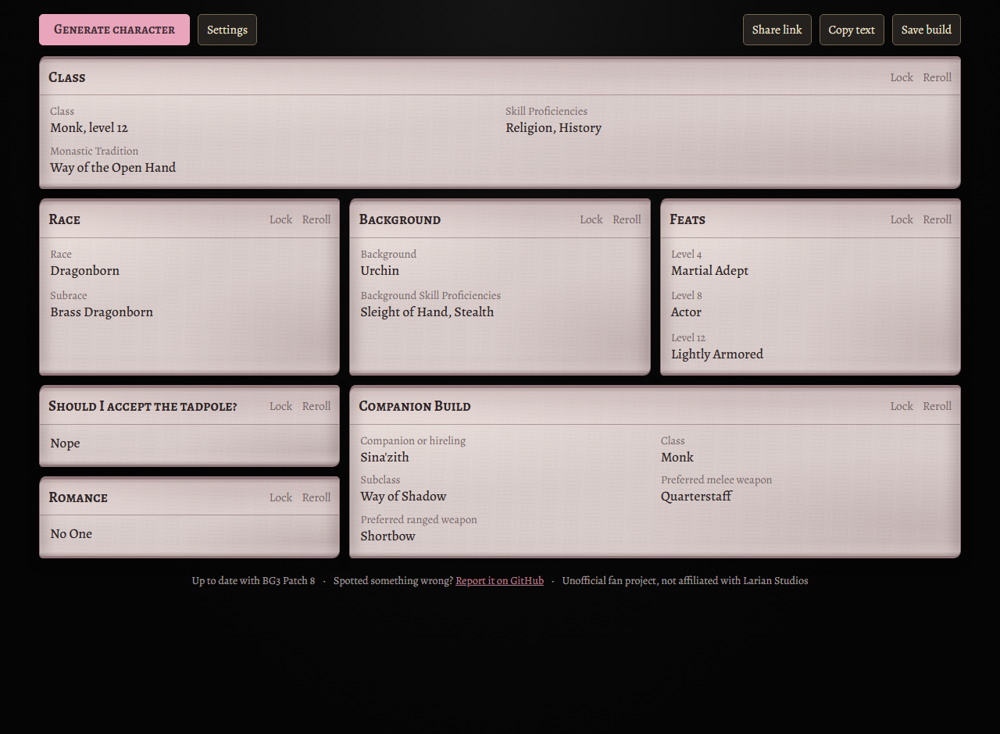

# Baldur's Gate 3 Character Generator

A small, browser-based character generator for Baldur's Gate 3. Generate a character, reroll individual sections, and save builds in your browser.

**Try it: https://thefallz.github.io/BG3CharacterGenerator/**

Up to date with Patch 8, the latest major patch. If you spot a rule that doesn't match the game, please [open an issue](https://github.com/TheFallZ/BG3CharacterGenerator/issues).

This is an unofficial fan project and is not affiliated with or endorsed by Larian Studios.

## Features

- **A full level 12 build in one click:** class and subclass, race and subrace, background, skills, and a feat for every feat level.
- **Class choices filled in:** fighting styles, maneuvers, metamagic, invocations, Wildheart aspects, Paladin oath prompts, and starting cantrips and spells for spellcasters.
- **Occasional multiclass builds,** with the level split shown on the Class card.
- **Story prompts:** whether to accept the tadpole, who to romance, and a deity for Clerics.
- **A build for a companion or hireling,** either in their usual class or a random new one, with preferred weapons.
- **Reroll any single card** without touching the rest of your build.
- **Lock cards you like** so they stay put when you generate again.
- **Save your favorite builds** to load, rename or delete later.
- **Works in any browser,** on desktop or phone, with no account or sign-up needed.

## Saved Builds

Saved builds stay in the browser you saved them in. They aren't uploaded anywhere, so they won't show up on another device or browser, and clearing your browser data removes them.
